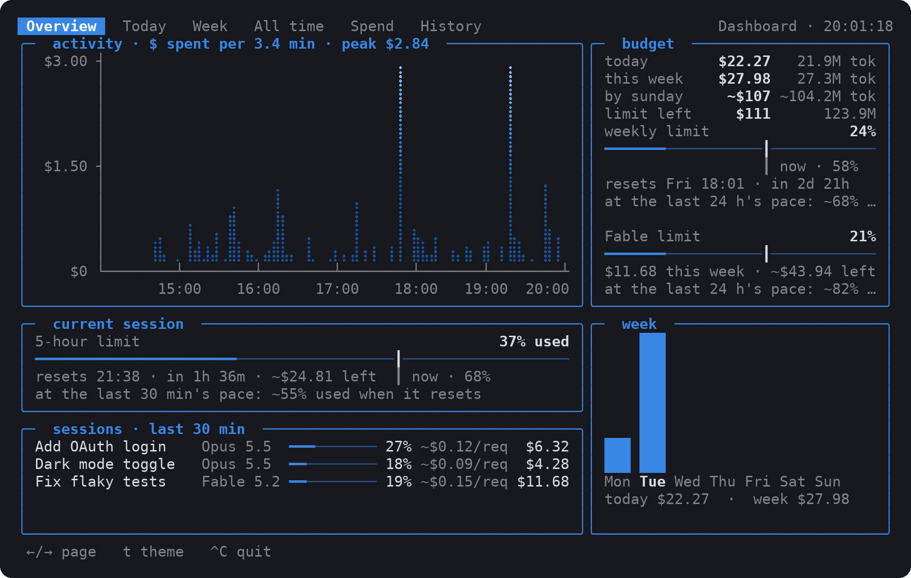
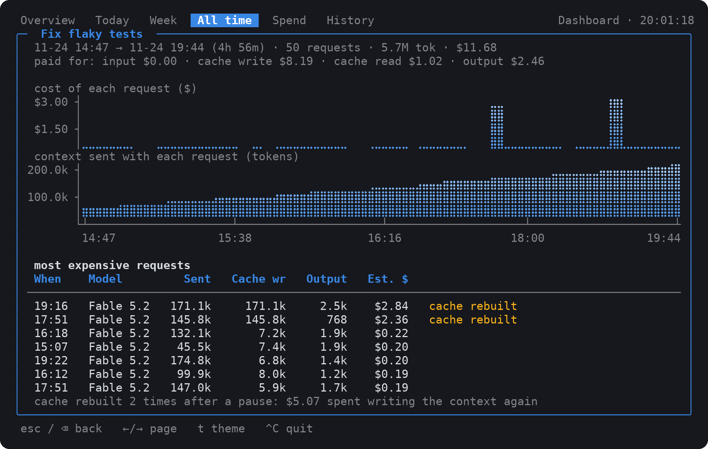
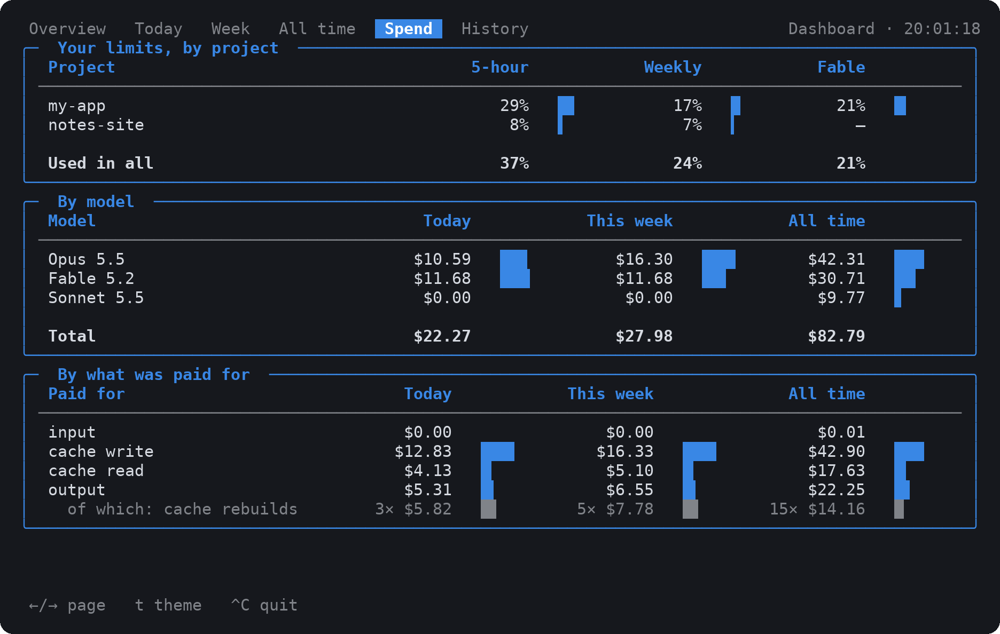
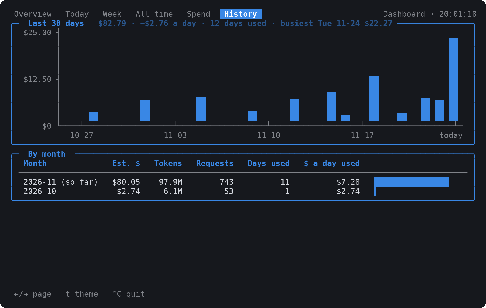

# claude-code-usage

A live terminal monitor for your Claude Code token usage, its estimated cost, and how much of
your plan's 5-hour, weekly and Fable limits is left. It reads the transcripts Claude Code already writes
on your machine, so nothing is sent anywhere unless you turn on `--usage-api` (see
[The Fable limit](#the-fable-limit-optional)). Built to sit in a quarter of your screen while you work.

> Unofficial. Not affiliated with or endorsed by Anthropic.



<sub>The Dashboard theme, drawn from made-up sessions, with `--usage-api` on for the Fable limit.</sub>

## What it shows

- **Overview**: today, this week, a projection to Sunday at your current pace, and meters for the
  5-hour limit ("Current session" in `/usage`), the weekly limit and, with `--usage-api`, the Fable limit
  ("Current week (Fable)", with what Fable used this week), each with an estimate of what is
  left and **when it runs out at your recent pace** ("runs out ~15:09, 36m before it resets"). The ┃ on
  a meter is now, how much of the window has gone by; when the fill passes it, you are using the limit
  faster than time. Each active session shows what one request costs at its context size, with a ⚠
  once the context passes 400k tokens. The Dashboard theme adds a chart of what you spent over the
  last 6 hours.
- **Alerts**: a desktop notification when a limit passes 80% and 90%, when it is on course to run
  out before it resets, and when a session's context passes 400k and 700k tokens. Each one once, and
  a limit's again after it is refilled early (a `/limit-reset`, a reset voucher).
- **Today / Week / All time**: every project, by the folder you started Claude Code in (`work/app`),
  sorted by cost. Open a project to see each session by its title, with its model, first and last use,
  requests, tokens and cost.
- **A session in detail**: press Enter on a session for the cost of each request and the context it
  sent over time, its most expensive requests, and how often its cache had to be rebuilt.
- **Spend**: how many points of each limit (Fable's too) each project used; where the money went, today / this
  week / all time, by model and by what was paid for (input, cache writes, cache reads, output); and
  what cache rebuilds after a pause cost.
- **History**: the last 30 days as a bar chart, and every month's totals.
- **Three themes**: Hero (one big figure), Dashboard (panels and a chart), Amber (a CRT look that
  paints its own background). The theme you close it on opens next time. See [Themes](#themes).
- The layout follows the window: about 80×24 is enough, and wider windows get more columns.

## Themes

Press `t` to switch. All three show the same numbers.

| Hero | Amber |
|---|---|
|  |  |

| A session in detail | Spend |
|---|---|
|  |  |

| History | |
|---|---|
|  | |

## Requirements

- Linux or macOS (it reads keys through `termios`)
- Python 3.10 or newer and [rich](https://github.com/Textualize/rich): `pip install rich`
- Claude Code. The optional limits mod uses Claude Code's mod support (early access); it was
  tested with Claude Code 2.1.331.

## Install

```bash
git clone https://github.com/Yanori1220/claude-code-usage.git
cd claude-code-usage
pip install rich
python3 cc_usage.py
```

That is enough for usage and cost. The limit meters need one more step.

### The limits mod (optional)

Claude Code knows how much of your 5-hour and weekly limits you have used, but it does not write
that to the transcripts. `limits-mod/` is a small Claude Code mod that writes those readings to a file
whenever they change, so `cc_usage.py` can show them. To load it in every Claude Code session, add its
folder to the `env` block of `~/.claude/settings.json`:

```json
{
  "env": {
    "CLAUDE_CODE_PLUGIN_DIRS": "/absolute/path/to/claude-code-usage/limits-mod"
  }
}
```

Then start a new Claude Code session. After its first reply, `~/cc-usage/ratelimits.json` appears and
the Overview shows the limits. Readings come only from a subscription plan; with an API key there are
no limits to show.

### The Fable limit (optional)

`/usage` also shows a weekly limit of Fable's own ("Current week (Fable)"). Claude Code hands that one
to neither mods nor the status line, so the only way to read it is to ask Anthropic, as `/usage` does.
`--usage-api` turns that on, and it stays on until `--no-usage-api`:

```bash
python3 cc_usage.py --usage-api
```

From then on it sends one request every 5 minutes to `api.anthropic.com/api/oauth/usage`, with Claude
Code's login token from `~/.claude/.credentials.json`. The token goes to Anthropic and nowhere else,
and is never stored or shown. Nor is it ever renewed, since that would replace the one Claude Code
holds: once it has expired, the requests wait until Claude Code next runs and renews it. This is an
endpoint Claude Code uses internally, not a public API, so it may change. On macOS Claude Code keeps
its login in the Keychain, which `cc_usage.py` does not read. The answers carry the 5-hour and weekly
readings too, so with `--usage-api` on the mod is optional.

## Keys

| Key | Does |
|---|---|
| ← / → | switch page |
| ↑ / ↓, PgUp / PgDn, Home / End | move through the project list |
| Enter or Space | open or close a project; on a session, open its own page |
| s | sort the project lists by cost or by last use (remembered) |
| Esc or Backspace | back from a session's page |
| t | switch theme |
| Ctrl-C | quit |

No other key does anything, and nothing you type is shown or left behind for your shell.

## Options

```bash
python3 cc_usage.py --page week      # start on another page: overview, today, week, all, spend, history
python3 cc_usage.py --theme amber    # start with another theme: hero, dash, amber
python3 cc_usage.py --once           # print one screen and exit
python3 cc_usage.py --every 5        # read the transcripts every 5 s instead of 2
python3 cc_usage.py --no-alerts      # no desktop notifications
python3 cc_usage.py --usage-api      # also read the plan's usage from Anthropic: the Fable limit (remembered)
python3 cc_usage.py --no-usage-api   # stop that (remembered)
```

Alerts use `notify-send` on Linux (the `libnotify-bin` package) and `osascript` on macOS; with neither,
none are sent.

The screenshots come from `python3 docs/make_screenshot.py` (needs Pillow), which draws them from
made-up sessions.

## Files

Everything it writes goes in one folder, `$CC_USAGE_DIR` (default `~/cc-usage`). If you change it,
set the variable for both `cc_usage.py` (your shell) and the mod (the `env` block above).

| File | What |
|---|---|
| `ratelimits.json` | the latest limit readings, written by the mod |
| `usage.json` | the latest readings from Anthropic, Fable's included, with `--usage-api` |
| `state.json` | the theme and sort it was last closed on, whether `--usage-api` is on, the alerts already sent (so a restart does not repeat them), and each limit's last reading and refill |
| `aliases.json` | optional, written by hand: `{"old/folder": "new-name"}`, for a project whose folder you renamed or copied, so its sessions are counted once, under one name. A key can also be a folder's name as Claude Code writes it, with `-` for `/` (`old-folder`) |

## How the numbers are worked out

- Claude Code writes one API response as several transcript lines, each repeating its usage, and the
  earlier lines carry a partial output count. Responses are merged by message id and request id,
  keeping the most complete line. Adding up every line would count most responses twice or more.
- Subagents are counted with the session that started them.
- **A project** is the folder its sessions started in (the transcripts' `cwd`), under your home folder:
  `work/app`. Claude Code's own folder names write `/` and `_` as `-` too, which cannot be undone.
- **Weeks run Monday to Sunday.** "This week", "By Sunday", the week's bars and what a model used this
  week count from Monday 00:00, whatever day a limit's own week resets on, and however often it was
  refilled.
- **Costs are estimates** at Anthropic's public API list prices (`PRICES` in `cc_usage.py`), with cache
  writes at 1.25× (5-minute) or 2× (1-hour) the input price. On a subscription, read them as "what this
  would cost on the API", not as a bill. A model missing from `PRICES` is shown without a cost; add it
  there when new models come out.
- **Limit estimates** take what you used inside a limit's window and divide it by the percentage
  used. A limit is not a plain token count (models weigh differently), and use outside Claude Code
  (claude.ai) counts toward it too, so the estimate reads low when you also use other apps.
- **The pace** is what you spent over the last 30 minutes (5-hour limit) or 24 hours (weekly limit),
  against that estimate, carried forward. It waits until a window is 15 minutes (or 6 hours) old and
  10% used: before that a 1% step in the reading would swing the prediction wildly.
- **Per request** is the average cost of a session's last five main-thread requests. Every request
  sends the whole conversation, so it grows with the context; past 400k tokens (`CONTEXT_WARN`) the
  session is marked, and `/compact` or a new session brings it down.
- **A limit refilled early** (a `/limit-reset`, a reset voucher) keeps its reset time, but its % then
  counts only what came after. When a reading falls 3 points or more within the same window, the
  estimates count from that reading: the allowance estimated before it holds until 10 points have been
  used after it.
- **The Fable limit** counts Fable's requests only (Fable 5, 5.1, 5.2 ...), and Fable's use counts toward
  the weekly limit as well.
- **Limits by project** divide what each project spent inside a limit's window (since its last refill)
  by the window's estimated allowance, so the rows add up to roughly the % used.
- **A cache rebuild** is a request, after a session's first, that had to write most of its prompt to
  the cache again: the cache had expired, usually after a pause. Writing costs more than reading, so
  these show up as spikes.
- Calls Claude Code does not write to a transcript are not counted.

## License

[MIT](LICENSE)
