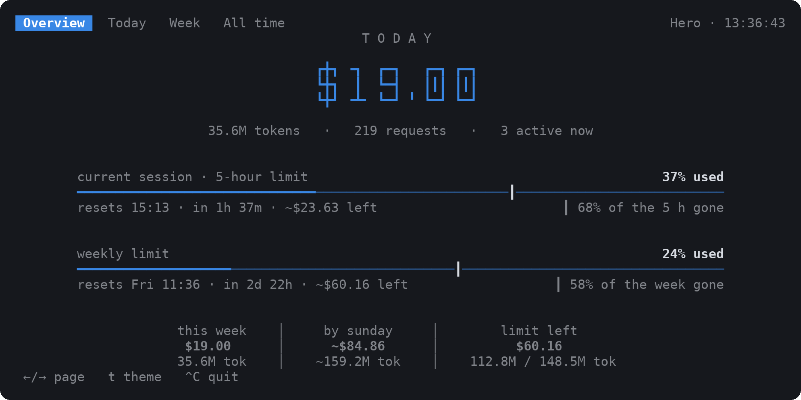
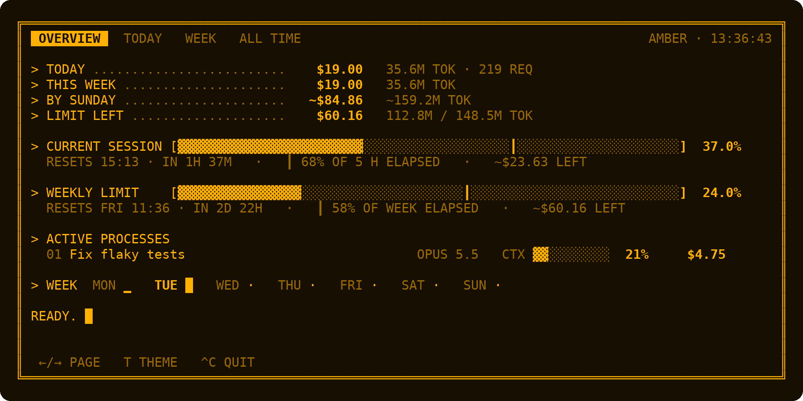

# claude-code-usage

A live terminal monitor for your Claude Code token usage, its estimated cost, and how much of
your plan's 5-hour and weekly limits is left. It reads the transcripts Claude Code already writes
on your machine, so nothing is sent anywhere. Built to sit in a quarter of your screen while you work.

> Unofficial. Not affiliated with or endorsed by Anthropic.


<sub>The Dashboard theme, drawn from made-up sessions.</sub>

## What it shows

- **Overview**: today, this week, a projection to Sunday at your current pace, and meters for the
  5-hour limit ("Current session" in `/usage`) and the weekly limit, each with an estimate of what is
  left. The Dashboard theme adds a chart of what you spent over the last 6 hours.
- **Today / Week / All time**: every project, sorted by cost. Open a project to see each session by
  its title, with its model, first and last use, requests, tokens and cost.
- **Three themes**: Hero (one big figure), Dashboard (panels and a chart), Amber (a CRT look that
  paints its own background). The theme you close it on opens next time. See [Themes](#themes).
- The layout follows the window: about 80×24 is enough, and wider windows get more columns.

## Themes

Press `t` to switch. All three show the same numbers.

| Hero | Amber |
|---|---|
|  |  |

## Requirements

- Linux or macOS (it reads keys through `termios`)
- Python 3.10 or newer and [rich](https://github.com/Textualize/rich): `pip install rich`
- Claude Code. The optional limits mod uses Claude Code's mod support (early access); it was
  tested with Claude Code 2.1.331.

## Install

```bash
git clone https://github.com/Yanori1220/claude-code-usage.git
cd claude-code-usage
pip install rich
python3 cc_usage.py
```

That is enough for usage and cost. The limit meters need one more step.

### The limits mod (optional)

Claude Code knows how much of your 5-hour and weekly limits you have used, but it does not write
that to the transcripts. `limits-mod/` is a small Claude Code mod that writes those readings to a file
whenever they change, so `cc_usage.py` can show them. To load it in every Claude Code session, add its
folder to the `env` block of `~/.claude/settings.json`:

```json
{
  "env": {
    "CLAUDE_CODE_PLUGIN_DIRS": "/absolute/path/to/claude-code-usage/limits-mod"
  }
}
```

Then start a new Claude Code session. After its first reply, `~/cc-usage/ratelimits.json` appears and
the Overview shows the limits. Readings come only from a subscription plan; with an API key there are
no limits to show.

## Keys

| Key | Does |
|---|---|
| ← / → | switch page |
| ↑ / ↓, PgUp / PgDn, Home / End | move through the project list |
| Enter or Space | open or close a project |
| t | switch theme |
| Ctrl-C | quit |

No other key does anything, and nothing you type is shown or left behind for your shell.

## Options

```bash
python3 cc_usage.py --page week      # start on another page: overview, today, week, all
python3 cc_usage.py --theme amber    # start with another theme: hero, dash, amber
python3 cc_usage.py --once           # print one screen and exit
python3 cc_usage.py --every 5        # read the transcripts every 5 s instead of 2
```

The screenshots come from `python3 docs/make_screenshot.py` (needs Pillow), which draws them from
made-up sessions.

## Files

Everything it writes goes in one folder, `$CC_USAGE_DIR` (default `~/cc-usage`). If you change it,
set the variable for both `cc_usage.py` (your shell) and the mod (the `env` block above).

| File | What |
|---|---|
| `ratelimits.json` | the latest limit readings, written by the mod |
| `state.json` | the theme it was last closed on |
| `aliases.json` | optional, written by hand: `{"old-project-folder": "new-name"}`, for a project whose folder you renamed or copied, so its sessions are counted once, under one name |

## How the numbers are worked out

- Claude Code writes one API response as several transcript lines, each repeating its usage, and the
  earlier lines carry a partial output count. Responses are merged by message id and request id,
  keeping the most complete line. Adding up every line would count most responses twice or more.
- Subagents are counted with the session that started them.
- **Costs are estimates** at Anthropic's public API list prices (`PRICES` in `cc_usage.py`), with cache
  writes at 1.25× (5-minute) or 2× (1-hour) the input price. On a subscription, read them as "what this
  would cost on the API", not as a bill. A model missing from `PRICES` is shown without a cost; add it
  there when new models come out.
- **Limit estimates** take what you used inside a limit's window and divide it by the percentage
  used. A limit is not a plain token count (models weigh differently), and use outside Claude Code
  (claude.ai) counts toward it too, so the estimate reads low when you also use other apps.
- Calls Claude Code does not write to a transcript are not counted.

## License

[MIT](LICENSE)
